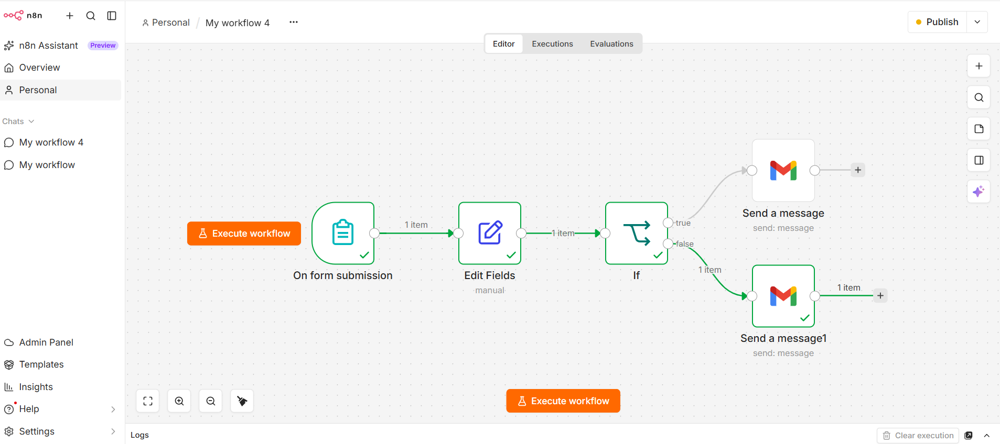

 # Scholarship Eligibility Email Automation

An n8n workflow that collects a student's details through a form, checks
whether their percentage is **greater than 90%**, and automatically
emails the eligibility result through Gmail.

## Workflow Overview

The workflow follows this sequence:

**Form Submission → Edit Fields → IF Condition → Gmail Email**

1.  **On form submission** --- Collects the student's first name,
    percentage, phone number, and email address. All four fields are
    required.
2.  **Edit Fields** --- Renames the first name to `Full Name` and
    formats the phone number with the `+91` country code.
3.  **If** --- Checks whether the submitted percentage is **strictly
    greater than 90**.
4.  **Eligible email** --- If the condition is true, Gmail sends an
    email with the subject **"Congratulations! You are eligible."**
5.  **Not eligible email** --- If the condition is false, Gmail sends an
    email with the subject **"Sorry! You are not eligible."**

## Eligibility Rule

The current IF node uses this condition:

`Percentage > 90`

    Submitted percentage Result
  ---------------------- --------------------
                     95% Eligible email
                     90% Not eligible email
                     75% Not eligible email

**Important:** A percentage of exactly 90 does not qualify under the
current condition. This workflow uses a simple configured threshold; it
does not verify all official scholarship requirements.

## Technologies Used

-   **n8n** --- Workflow automation
-   **n8n Form Trigger** --- Collects student information
-   **Edit Fields node** --- Formats selected form values
-   **IF node** --- Routes the workflow based on the percentage
    condition
-   **Gmail node** --- Sends the result email

## Features

-   Collects required student details through a form
-   Checks the submitted percentage automatically
-   Sends different email messages for the two outcomes
-   Uses the student's submitted email address as the recipient
-   Personalizes the email with the student's first name and percentage
-   Formats the phone number with India's `+91` country code

## Email Examples

### Eligible

**Subject:** Congratulations! You are eligible.

The email greets the student by name, includes their submitted
percentage, and states that they are eligible.

### Not eligible

**Subject:** Sorry! You are not eligible.

The email greets the student by name, includes their submitted
percentage, and states that they are not eligible.

## Setup

1.  Import the exported workflow JSON into your n8n instance.
2.  Check the form fields and the IF node's percentage condition.
3.  Connect your own Gmail OAuth2 credentials to both Gmail nodes.
4.  Confirm the recipient field uses the email submitted through the
    form.
5.  Test with percentages above 90 and at or below 90.
6.  Activate or publish the workflow according to your n8n setup.

## Repository Contents

-   `README.md` --- Project documentation
-   `scholarship eligibility mail automation.json` --- Exported n8n
    workflow
-   `workflow.png` --- Workflow screenshot (optional; add the screenshot
    file using this name)

If you add the screenshot to the repository as `workflow.png`, the image
can be displayed below:

## Notes

-   The phone number is formatted in the **Edit Fields** node, but it is
    not currently used in either email message.
-   The workflow checks only the percentage condition configured in the
    IF node. It does not validate income, course, institution, or other
    scholarship-specific requirements.
-   Before sharing the exported workflow publicly, review it for
    personal information and sensitive configuration details. Do not
    publish credentials, access tokens, or other secrets.

## Purpose

This project demonstrates a practical use of workflow automation to
collect form data, apply conditional logic, and send personalized email
notifications without manually processing each submission.
